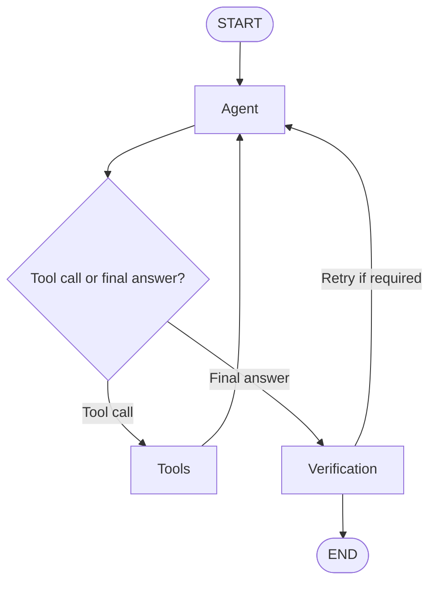
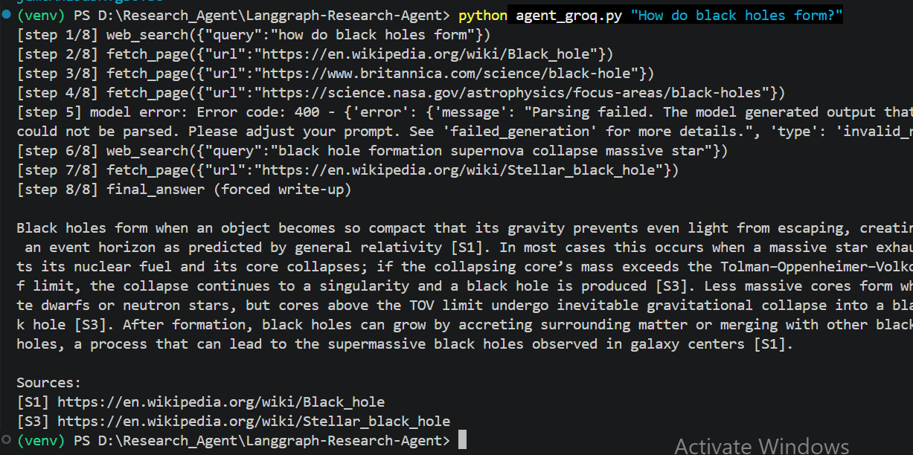
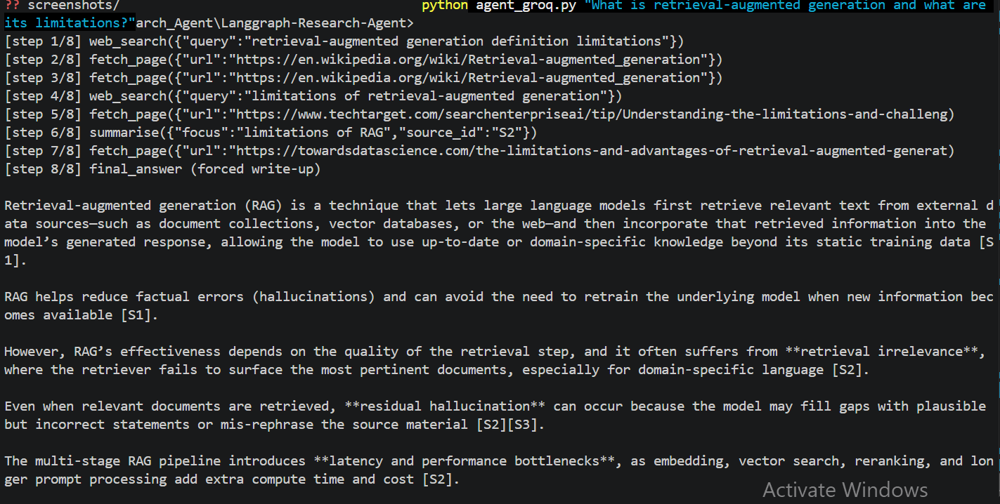
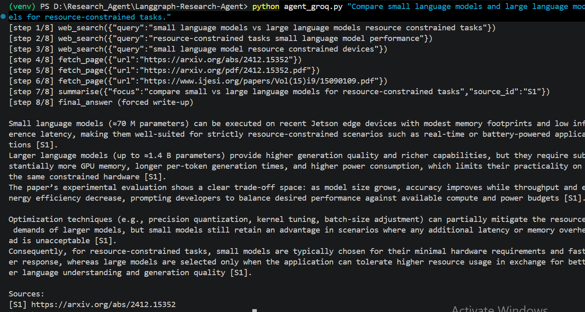
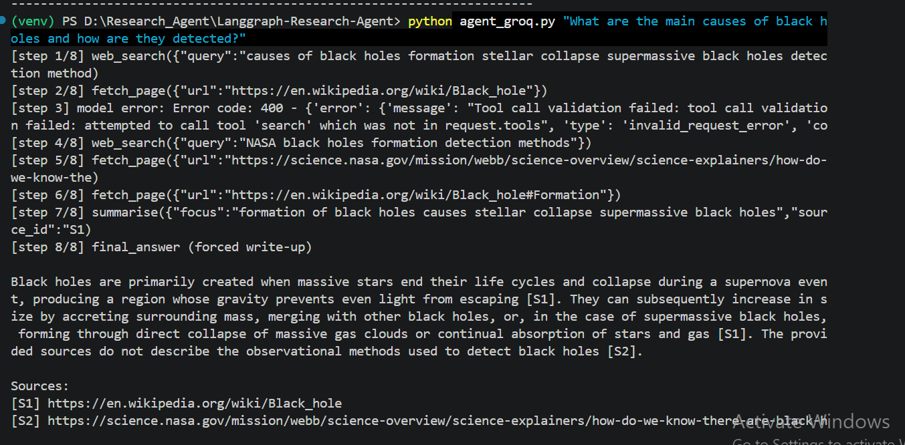

# LangGraph Research Agent

A tool-using research agent built with LangGraph and Groq. The agent searches the web, fetches webpages, summarizes retrieved content, and generates answers with source references.

This repository documents the **baseline implementation** and its initial experiments. Evidence-grounded citation verification, caching, state isolation, and automated evaluation are planned improvements, not implemented features.

## Features

- LangGraph state machine with agent, tools, and verification nodes.
- Groq LLM integration.
- DuckDuckGo web search using `ddgs`.
- Webpage retrieval using Requests and BeautifulSoup.
- Source IDs for fetched webpages.
- Small-model summarization.
- Citation ID validation.
- Configurable execution budget (default: 8 steps).
- Run output logging.

## Architecture



| Node | Responsibility |
|---|---|
| agent | Selects tools or generates the final answer |
| tools | Executes web search, page fetching, and summarization |
| verify | Checks citation references against registered source IDs |

## Technology Stack

- Python
- LangGraph
- Groq API
- DuckDuckGo Search (`ddgs`)
- Requests
- BeautifulSoup

## Models

| Purpose | Default model |
|---|---|
| Main research agent | `openai/gpt-oss-120b` |
| Summarization | `openai/gpt-oss-20b` |

## Baseline Experiments

The following experiments were executed using the original implementation before planned improvements.

### Experiment 1: Black hole research

Question: How do black holes form and how can they be detected?



### Experiment 2: RAG limitations

Question: What is retrieval-augmented generation and what are its limitations?



Observed limitation: the agent attempted duplicate retrieval and reached its execution budget.

### Experiment 3: Small Language Models vs Large Language Models

Question: Compare small language models and large language models for resource-constrained tasks.



Observed limitations:
- PDF extraction was not properly implemented.
- Only one source was cited in the final answer.
- Citation support was not independently verified.

### Additional Baseline Capture



## Installation

Python 3.10 or newer is recommended.

### Windows PowerShell

```powershell
git clone https://github.com/Saleha198/LangGraph-Research-Agent.git
cd LangGraph-Research-Agent

python -m venv venv
venv\Scripts\Activate.ps1

pip install -r requirements-groq.txt
```

### Configure Groq API Key

Create a free API key at:

https://console.groq.com/

Set the key in PowerShell:

```powershell
$env:GROQ_API_KEY="your_groq_api_key"
```

Do not commit your API key or `.env` file.

### Run the Agent

```powershell
python agent_groq.py "How do black holes form?"
```

Print the graph:

```powershell
python agent_groq.py --graph
```

## Configuration

| Environment variable | Default | Description |
|---|---|---|
| `GROQ_API_KEY` | None | Groq API authentication |
| `AGENT_MODEL` | `openai/gpt-oss-120b` | Main agent model |
| `SUMMARY_MODEL` | `openai/gpt-oss-20b` | Summarization model |
| `MAX_STEPS` | `8` | Maximum execution steps |

## Project Structure

```text
LangGraph-Research-Agent/
├── agent_groq.py
├── agent_groq_original.py
├── requirements-groq.txt
├── README.md
├── .gitignore
├── screenshots/
└── runs/
```

## Known Limitations

- Citation verification checks source references, not whether the cited content actually supports each claim.
- Global source storage can create state-isolation problems between runs.
- Duplicate searches and webpage fetches are not comprehensively prevented.
- PDF extraction is not properly supported.
- The agent may consume its execution budget on unnecessary tool calls.
- Results depend on retrieved webpage quality and model-generated responses.
- Groq free-tier rate limits may affect execution.

## Planned Improvements

1. Run-specific source state and structured metrics.
2. Search and fetch caching with URL deduplication.
3. Evidence-based citation verification.
4. Multi-part question coverage checks.
5. Robust tool-call validation and error handling.
6. Automated tests with mocked external services.
7. Baseline-versus-improved evaluation.

## License

To be added.
